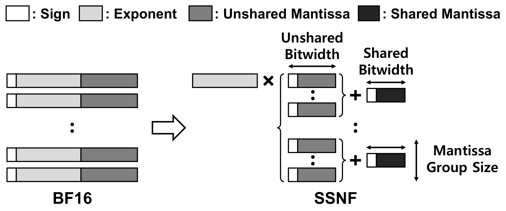
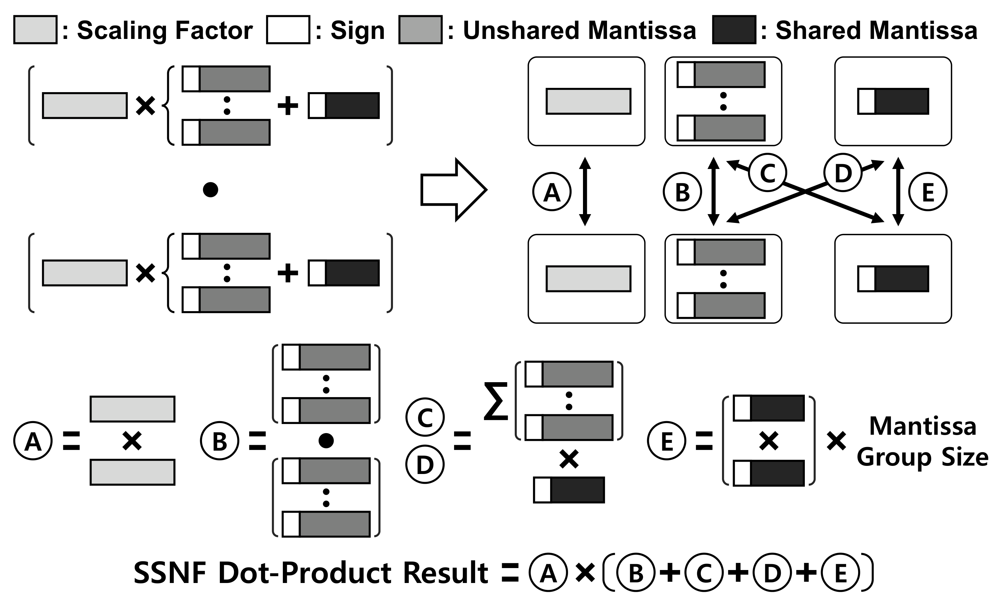

# Scaled² Numeric Format (SSNF)

The Scaled² Numeric Format (SSNF) extends sharing from block-level scaling factors to group-level low-order mantissa fields. Existing scaled numeric formats share one scaling factor across a block of values, but the remaining precision bits are stored independently for every value. In SSNF, each value stores an unshared high-order field, while values within a smaller group share a low-order field that improves numerical resolution at a fraction of the storage cost of independently stored bits. SSNF combines activation-weighted offline quantization for model weights, residual-based on-the-fly quantization for dynamic key-value (KV) caches, and direct dot-product arithmetic over the shared and unshared fields.

Across Llama-3.1-8B, Mistral-7B, and Llama-2-7B, SSNF increases WikiText-2 perplexity (PPL) by at most 2.95% relative to BF16 while using 5.63 bits per weight element and an average of 4.91 bits per KV cache element. SSNF supports 1.26x the maximum batch size of MXFP6 and 9.60x that of BF16. SSNF also improves large language model (LLM) serving throughput by 1.62–2.25x over BF16 across input sequence lengths from 2K to 16K tokens.

## SSNF Representation

<p align="center"></p>
<p align="center"><em>Figure 1. Hierarchical SSNF representation (<a href="docs/figures/ssnf-format.pdf">PDF</a>).</em></p>

Figure 1 illustrates the hierarchical SSNF representation. SSNF partitions a tensor into scaling blocks and divides each block into smaller mantissa groups. Each scaling block shares a power-of-two scaling factor, and each mantissa group shares low-order mantissa bits. Every value independently stores the remaining high-order bits, referred to as *unshared bits*. The scaling factor captures the common range of a block, while mantissa sharing provides additional resolution within each group.

SSNF reconstructs an integer by shifting the signed unshared field above the shared-bit positions and adding the signed shared field. The scaling factor converts the reconstructed integer into the dequantized value. SSNF uses a signed shared field because an unsigned field requires floor rounding of the unshared field and introduces a directional quantization bias. Such biased errors propagate through attention-output computations, degrading KV cache accuracy.

The shared bitwidth and mantissa group size control the storage–accuracy trade-off: additional shared bits increase representational flexibility, whereas larger groups reduce storage at the cost of sharing a low-order component across more values. For example, one bit shared across eight values adds only 0.125 bits per value. The selected SSNF configurations each use one E8M0 scale per 32 values:

| Configuration | Per-value field | Shared field | Bits/value |
|---|---|---|---:|
| SSNF-W (model weights) | 5-bit signed upper | 3-bit lower/8 | 5.63 |
| SSNF-K (KV-cache keys) | 5-bit signed upper | 3-bit lower/16 | 5.44 |
| SSNF-V (KV-cache values) | 4-bit signed upper | 4-bit lower/32 | 4.38 |

"3-bit lower/8" denotes a 3-bit lower-order field shared by eight values.

## SSNF Arithmetic

<p align="center"></p>
<p align="center"><em>Figure 2. Dot-product computation with SSNF (<a href="docs/figures/ssnf-arithmetic.pdf">PDF</a>).</em></p>

Figure 2 illustrates a dot product using SSNF without per-element BF16 reconstruction. Each operand comprises a scaling factor and, for each mantissa group, shifted unshared fields and a shared field. Multiplying the two operands produces one unshared–unshared partial product, two unshared–shared partial products, and one shared–shared partial product:

| | Computation |
|---|---|
| A | Product of the two scaling factors |
| B | Dot product of the two unshared mantissas: the unshared–unshared partial product |
| C, D | Sum of the unshared mantissas of one operand in a mantissa group, multiplied by the shared mantissa of the other operand: the two unshared–shared partial products |
| E | Product of the two shared mantissas, multiplied by the mantissa group size: the shared–shared partial product |

The SSNF dot-product result is A × (B + C + D + E). B requires one product per value, whereas C, D, and E require one product each per mantissa group, and A requires one product per scaling block.

**Energy.** An SSNF dot-product unit on an Alveo U250 FPGA exhibits 91.86% less energy than a BF16 dot-product unit, at the unit level. For SSNF-W operands, the SSNF unit uses 5x5-bit unshared–unshared partial products for each value, 3x8-bit unshared–shared and 3x3-bit shared–shared partial products for each mantissa group, integer accumulation, and a final FP32 conversion; the BF16 unit uses 8x8-bit products and FP32 adders. [`extended/fpga`](extended/fpga) provides the FPGA implementation of the SSNF, MXINT8, and BF16 dot-product units and the energy measurement of each unit.

**Dequantization.** SSNF can also operate on existing hardware through dequantization. The dequantization kernel extracts and sign-extends the unshared and shared fields, shifts the unshared field, and adds the two fields. The reconstructed integer is converted to BF16, and the power-of-two scale is applied through exponent adjustment. The resulting values run on existing CUDA or Tensor Cores without datapath modifications. The SSNF CUDA kernels in [`core/kernel`](core/kernel) implement this dequantization.

## Repository Layout

| Directory | Contents |
|---|---|
| [`core/`](core) | SSNF quantization, SSNF CUDA kernels, vLLM integration, calibration statistics, and the accuracy and serving evaluation, together with configurations and logs. [`core/README.md`](core/README.md) describes environments, builds, and reproduction. |
| [`extended/`](extended) | Additional experiments that use `core/`: comparisons with AMS-Quant, tensor-wise MXFP4/MXFP6 mixed precision, and KIVI, KVQuant, and QServe; the contribution of each calibration statistic; Llama-2-13B accuracy and serving; IFEval; on-the-fly KV cache quantization overhead; and the FPGA implementation of the dot-product units. [`extended/README.md`](extended/README.md) lists each experiment with its results. |
| [`docs/figures/`](docs/figures) | Figures 1 and 2 in PNG and PDF. |

## Quick Start

### SSNF Evaluation (`core/`)

The accuracy evaluation runs in PyTorch. The serving evaluation requires the SSNF CUDA kernels and vLLM 0.23. See [`core/README.md`](core/README.md), §2–§4.

```bash
cd core
pip install -r env/requirements_accuracy.txt
bash experiments/accuracy-sweep/run.sh        # configuration search (WikiText-2 PPL)

pip install -r env/requirements_serving.txt   # separate environment
python env/apply_vllm_patches.py
python setup.py build_ext --inplace           # SSNF CUDA kernels for sm_120
bash experiments/serving-throughput/run.sh    # serving throughput
```

### Additional Experiments (`extended/`)

The accuracy experiments use the accuracy environment of `core/`, and the serving experiments use the serving environment of `core/` with the SSNF CUDA kernels that `extended/serving/prepare.py` builds from `core/`. Each experiment has one `run.sh`; `SSNF_MODEL_DIR` sets a local model directory, and `SSNF_GPU_UUID` sets the GPU for the serving experiments. See [`extended/README.md`](extended/README.md) for the results of each experiment; the QServe evaluation is described there (§6).

```bash
cd extended
pip install -r ../core/env/requirements_accuracy.txt
(cd accuracy && python prepare_wikitext.py)                        # WikiText-2 text

# Accuracy
bash accuracy/experiments/ams_quant/run.sh                         # AMS-Quant comparison
bash accuracy/experiments/tensorwise_mixed_precision/run.sh llama31 # tensor-wise mixed precision
bash accuracy/experiments/calibration_statistics/run.sh llama31    # calibration statistics
bash accuracy/experiments/llama2_13b/run.sh                        # Llama-2-13B PPL (two GPUs)

bash third_party/fetch.sh work                                     # original KIVI, KVQuant, QServe, and IFEval code
bash accuracy/experiments/ifeval/run.sh llama31i                   # IFEval
bash accuracy/experiments/kv_cache_baselines/run.sh work           # KIVI and KVQuant; environments in the script header

# Serving (serving environment of core/)
python serving/prepare.py build                                    # SSNF CUDA kernels -> serving/build
export SSNF_GPU_UUID=<GPU UUID from nvidia-smi -L>
bash serving/llama31_8b_capacity/run.sh                            # Llama-3.1-8B batch size and decode throughput
bash serving/kv_quant_overhead/run.sh                              # on-the-fly KV cache quantization overhead
SSNF_MODEL_DIR=<local Llama-2-13b-hf> bash serving/llama2_13b_capacity/run.sh   # Llama-2-13B serving
```

### FPGA Experiments (`extended/fpga/`)

The FPGA experiments require an Alveo U250 with the `xilinx_u250_gen3x16_xdma_4_1_202210_1` platform, Vitis/Vivado 2023.1, and XRT; RTL simulation requires Icarus Verilog 12 or later. The experiments proceed in three steps: RTL simulation against the Python reference, one FPGA image for each of SSNF, MXINT8, and BF16, and power measurement with the units inactive and active. See [`extended/fpga/README.md`](extended/fpga/README.md) for the FPGA setup, the commands, and the measurement procedure.

## License

Apache License 2.0. See [`LICENSE`](LICENSE). The KIVI, KVQuant, QServe, and IFEval code used in `extended/` is not part of this repository; [`extended/third_party/fetch.sh`](extended/third_party/fetch.sh) obtains it from the original repositories, which keep their own licenses.
